<picture>
  <source media="(prefers-color-scheme: dark)" srcset="assets/header-dark.svg">
  
</picture>

  <a href="https://muammertekin.com"><b>muammertekin.com</b></a>&nbsp;&nbsp;·&nbsp;&nbsp;<a href="https://labellingo.com">labellingo.com</a>&nbsp;&nbsp;·&nbsp;&nbsp;<a href="https://www.linkedin.com/in/muammer-tekin/">LinkedIn</a>&nbsp;&nbsp;·&nbsp;&nbsp;<a href="mailto:hello@muammertekin.com">hello@muammertekin.com</a>

Most of what I do sits on both sides of the same product: the app on someone's phone, and everything behind it that keeps it working. I take ideas all the way through, from the first sketch to the store release and the servers after it.

### Projects

<a href="https://labellingo.com"><picture><source media="(prefers-color-scheme: dark)" srcset="assets/projects/labellingo-dark.svg"></picture></a>
<picture><source media="(prefers-color-scheme: dark)" srcset="assets/projects/vibesager-dark.svg"></picture>

### In numbers

<picture>
  <source media="(prefers-color-scheme: dark)" srcset="assets/stats-dark.svg">
  
</picture>

Almost all of my work is in private repositories, so this card is built from the GitHub API every night by <a href="scripts/build.mjs">a small script</a>.

### Tools I reach for

<picture>
  <source media="(prefers-color-scheme: dark)" srcset="https://skillicons.dev/icons?i=flutter%2Cdart%2Cts%2Cnestjs%2Cmongodb%2Credis%2Cpython%2Cfastapi%2Cnextjs%2Csupabase%2Cfirebase%2Cpostgres%2Cdocker%2Cgithubactions%2Clinux%2Cfigma&perline=16&theme=dark">
  
</picture>
